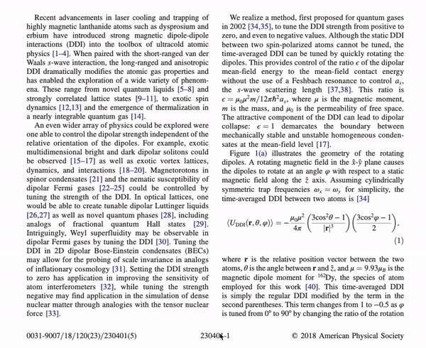

# PDF Ref Preview

Preview internal links in PDFs on mouse hover.

<p align="center">
  
</p>

The script works by following internal links to the target page and location, and render the view in a separate canvas. Some PDFs may not work because the internal links are broken.

This script only works if the viewer is [PDF.js](https://github.com/mozilla/pdf.js/).

## Firefox

PDF.js is the default viewer in Firefox. To install the script, create a bookmark and add the code below to the `location` or `URL` field.
See [issue #2](https://github.com/belinghy/PDFRefPreview/issues/2) for ideas on customizing the script to individual preferences.

```js
javascript:(async function togglePreview() {
  const app = window.PDFViewerApplication;
  const anchor = document.getElementById("viewer");
  if ("_previewHandler" in app) {
    anchor.removeEventListener("mouseover", app._previewHandler);
    delete app._previewHandler;
    delete app._previewing;
    return;
  }
  const doc = app.pdfDocument;
  app._previewing = false;

  async function resolveTarget(hash) {
    let raw = hash.substring(1);
    try { raw = decodeURIComponent(raw); } catch (e) { raw = unescape(raw); }
    let dest = null;
    let top = null;
    if (raw.startsWith("[")) {
      dest = JSON.parse(raw);
    } else if (raw.includes("=")) {
      const params = new URLSearchParams(raw);
      if (params.has("nameddest")) {
        dest = await doc.getDestination(params.get("nameddest"));
      } else if (params.has("page")) {
        const zoom = (params.get("zoom") || "").split(",");
        if (zoom.length >= 3 && zoom[2] !== "") top = parseFloat(zoom[2]);
        return { pageNumber: parseInt(params.get("page"), 10), top: top };
      }
    } else {
      dest = await doc.getDestination(raw);
    }
    if (!Array.isArray(dest)) return null;
    const ref = dest[0];
    let pageNumber;
    if (Number.isInteger(ref)) {
      pageNumber = ref + 1;
    } else {
      pageNumber = doc.cachedPageNumber(ref) || (await doc.getPageIndex(ref)) + 1;
    }
    switch (dest[1] && dest[1].name) {
      case "XYZ": top = dest[3]; break;
      case "FitH": case "FitBH": top = dest[2]; break;
      case "FitR": top = dest[5]; break;
    }
    return { pageNumber: pageNumber, top: top };
  }

  async function mouseoverHandler(event) {
    const link = event.target.closest && event.target.closest("[data-internal-link] a");
    if (!link || app._previewing) return;
    app._previewing = true;
    const parent = link.parentElement;
    let left = false;
    let preview = null;
    parent.addEventListener("mouseleave", function () {
      left = true;
      if (preview) preview.remove();
      app._previewing = false;
    }, { once: true });

    let target = null;
    try { target = await resolveTarget(link.hash); } catch (e) { console.log("RefPreview: could not resolve link", link.hash, e); }
    if (!target || left) { app._previewing = false; return; }
    const page = await doc.getPage(target.pageNumber);
    if (left) return;

    const base = page.getViewport({ scale: 1.0 });
    const top = (target.top == null || isNaN(target.top)) ? base.height : target.top;
    const cssScale = 1.2 * app.pdfViewer.currentScale;
    const width = base.width * cssScale;
    const frac = Math.min(1, Math.max(0.25, 1 - Math.abs(top - base.height) / base.height));

    const scale = 4;
    const viewport = page.getViewport({ scale: scale, offsetY: (top - base.height + 5) * scale });

    preview = document.createElement("canvas");
    const s = preview.style;
    s.border = "1px solid black";
    s.direction = "ltr";
    s.position = "fixed";
    s.zIndex = "99";
    s.boxShadow = "5px 5px 5px black, -5px 5px 5px black";
    s.background = "white";
    const box = anchor.getBoundingClientRect();
    const halfWidth = (box.left + box.right) / 2;
    const leftOffset = event.clientX > halfWidth ? (2 * width) / 3 : width / 3;
    s.left = `${event.clientX - leftOffset - 4}px`;
    s.top = `${event.clientY + 4}px`;
    s.width = `${width}px`;
    s.height = `${base.height * cssScale * frac}px`;
    preview.width = viewport.width;
    preview.height = viewport.height * frac;

    anchor.prepend(preview);
    page.render({ canvas: preview, canvasContext: preview.getContext("2d"), viewport: viewport }).promise.catch(function (e) { console.log("RefPreview: render failed", e); });
  }

  anchor.addEventListener("mouseover", mouseoverHandler);
  app._previewHandler = mouseoverHandler;
})();
```

## Chrome

To use in Chrome, follow the build and install instructions `src/pdf.js` README file for Chrome, e.g.,

```sh
git clone git@github.com:belinghy/PDFRefPreview.git --recu
cd PDFRefPreview/src/pdf.js

npm install -g gulp-cli
npm install
gulp chromium
```

Then open Chrome, go to `Tools > Extension` and load the (unpackaged) extension from the directory `build/chromium`.

The preview function can be customized by tweaking `src/pdf.js/web/pdf_ref_preview.js`.
The `togglePreview` function is called in `src/pdf.js/web/app.js`.

By default, the preview function is enabled on every PDF and can be toggled by pressing `q`.
